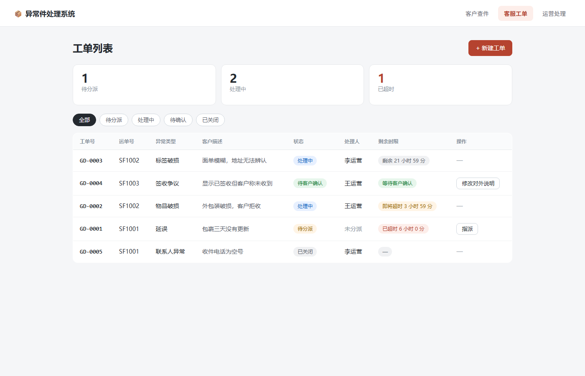
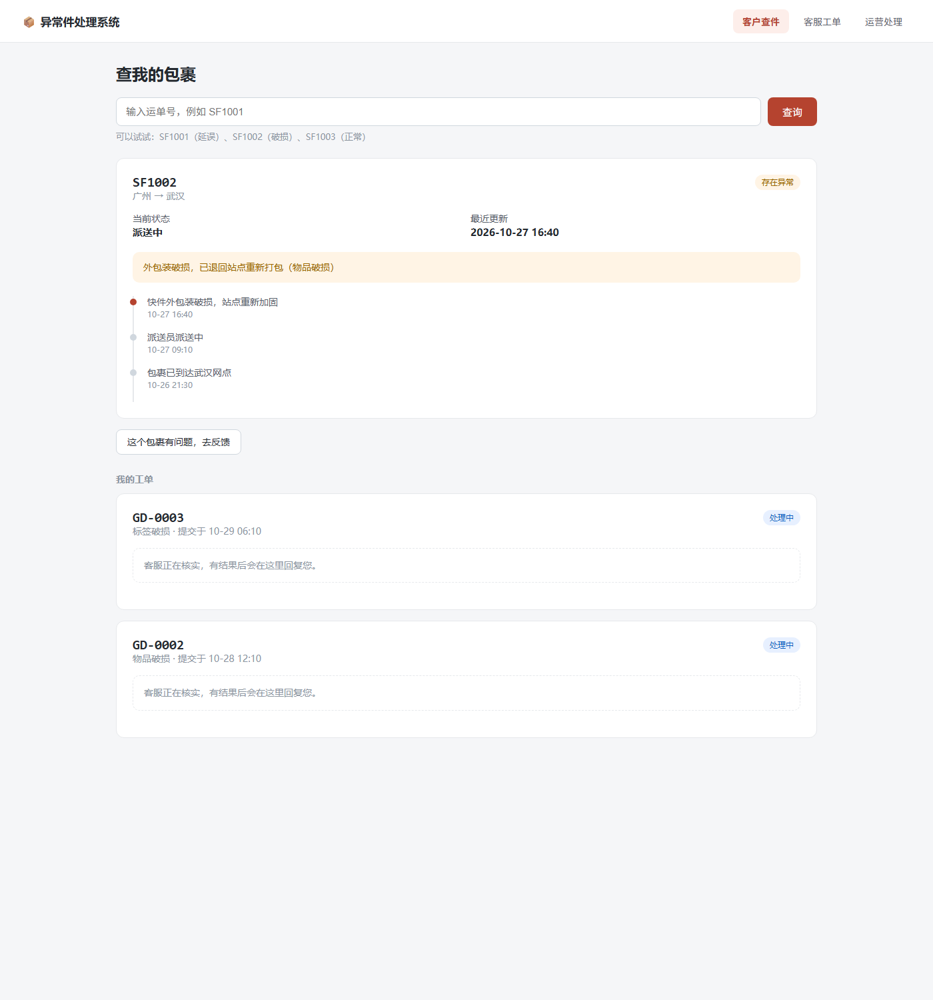
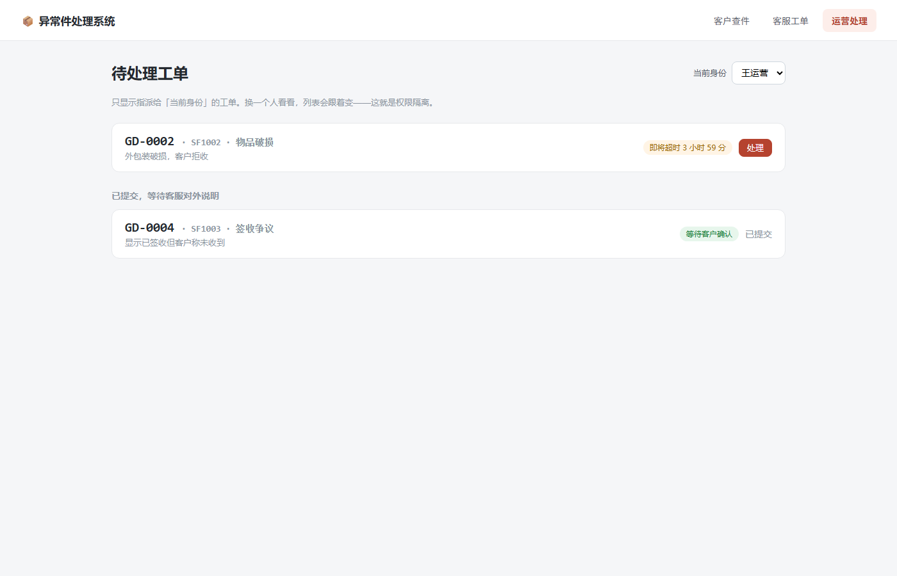

# 快递异常件处理系统

一个面向快递公司客服与站点的**异常件处理系统**：客户查件并反馈异常，客服建单分派，运营核实处理，客服对外说明，客户确认闭环。

不是"展示全国物流轨迹"的系统，而是**处理那一件没有正常到达的包裹**——延误、破损、标签破损、联系人异常、签收争议。



## 目录

- [功能](#功能)
- [技术栈](#技术栈)
- [项目结构](#项目结构)
- [快速开始](#快速开始)
- [接口文档](#接口文档)
- [数据模型](#数据模型)
- [关键设计](#关键设计)
- [测试](#测试)
- [已知限制](#已知限制)

## 功能

### 客户视角

- 输入运单号查询包裹状态与物流轨迹
- 发现异常时提交反馈（选择异常类型 + 描述）
- 查看自己工单的处理进度与客服回复
- 处理完成后确认解决，或选择"不认可"退回重办



### 客服视角

- 工单列表，按状态筛选（待分派 / 处理中 / 待确认 / 已关闭）
- 新建工单、指派处理人
- 把运营的内部结论整理成**客户能看懂**的对外说明
- 处理时限监控：剩余时间、即将超时、已超时

### 运营视角

- 只看到指派给自己的工单（最小权限）
- 记录核实过程（内部备注）与处理结果（内部）
- 提交后进入"待客户确认"，由客服对外说明



## 技术栈

| 层 | 选型 | 说明 |
|---|---|---|
| 前端 | 原生 HTML / CSS / JavaScript | 无框架、无构建步骤，直接由后端托管 |
| 后端 | Node.js 24 + Express 5 | REST 风格接口 |
| 数据库 | SQLite（`node:sqlite` 内置模块） | 零安装、单文件，适合课程项目与小型部署 |

> 需要 Node.js **≥ 22.5**（`node:sqlite` 从该版本开始提供），推荐使用 Node 24。

## 项目结构

```
express-exception/
├── public/                  # 前端（由后端静态托管）
│   ├── index.html
│   ├── style.css
│   └── app.js
├── server/                  # 后端
│   ├── index.js             # 路由、校验、启动
│   ├── db.js                # 数据库连接与建表
│   ├── seed.js              # 首次启动写入演示数据
│   ├── shipments.js         # 运单数据（模拟）
│   ├── test-api.js          # 接口边界测试脚本
│   └── package.json
├── data/app.db              # SQLite 数据库（运行时生成，已 gitignore）
└── docs/screenshots/        # README 截图
```

分层原则：**路由只负责收参和返回，状态机与校验集中在函数里，数据访问集中在 `db` 上**。

## 快速开始

```bash
cd server
npm install
npm run dev
```

看到以下输出即启动成功：

```
API 已启动：http://localhost:3000
前端页面：  http://localhost:3000/index.html
```

浏览器打开 <http://localhost:3000/index.html>。

演示运单号：`SF1001`（延误）、`SF1002`（破损）、`SF1003`（正常）。

`npm run dev` 使用 `node --watch`，修改服务端代码会自动重启。

**重置数据**：停止服务，删除 `data/` 目录，重新启动即可重新写入演示数据。

## 接口文档

基础地址：`http://localhost:3000`

| 方法 | 路径 | 说明 | 权限 |
|---|---|---|---|
| GET | `/api/health` | 健康检查 | — |
| GET | `/api/shipments/:id` | 查询运单 | 客户 |
| GET | `/api/tickets` | 工单列表，支持 `?status=` `?assignee=` `?trackingId=` | 客服 / 运营 |
| GET | `/api/tickets/:id` | 单个工单详情 | — |
| POST | `/api/tickets` | 创建工单 | 客户 |
| POST | `/api/tickets/:id/assign` | 指派处理人 | 客服 |
| POST | `/api/tickets/:id/result` | 提交处理结果 | 运营（须为被分派人） |
| POST | `/api/tickets/:id/explain` | 生成对外说明 | 客服 |
| POST | `/api/tickets/:id/confirm` | 客户确认解决 | 客户 |
| POST | `/api/tickets/:id/reject` | 客户不认可，退回重办 | 客户 |

### 请求示例

```http
POST /api/tickets
Content-Type: application/json

{
  "trackingId": "SF1002",
  "type": "物品破损",
  "note": "外包装破损，客户拒收"
}
```

```http
POST /api/tickets/GD-0006/result
Content-Type: application/json

{
  "operator": "张运营",
  "internalNotes": "已联系武汉站点，确认外箱破损",
  "result": "已重新打包，安排次日派送"
}
```

### 状态码约定

| 码 | 含义 |
|---|---|
| 200 / 201 | 成功 / 创建成功 |
| 400 | 参数错误（缺字段、类型不合法、运单不存在） |
| 403 | 无权限（不是被分派人却提交结果） |
| 404 | 资源不存在 |
| 409 | 状态冲突（当前状态不允许该操作） |
| 500 | 服务端异常 |

## 数据模型

### `tickets`

| 字段 | 类型 | 说明 |
|---|---|---|
| `id` | TEXT | 工单号，如 `GD-0001` |
| `tracking_id` | TEXT | 运单号 |
| `type` | TEXT | 异常类型 |
| `status` | TEXT | `pending` / `processing` / `resolved` / `closed` |
| `assignee` | TEXT | 处理人，空串表示未分派 |
| `created_at` | TEXT | 创建时间（ISO 8601 字符串） |
| `note` | TEXT | 客户描述 |
| `internal_notes` | TEXT | 运营核实过程（**客户不可见**） |
| `result` | TEXT | 处理结果（**客户不可见**） |
| `customer_visible_note` | TEXT | 客服整理的对外说明（客户可见） |

### `ticket_history`

| 字段 | 说明 |
|---|---|
| `ticket_id` | 所属工单 |
| `time` | 发生时间 |
| `text` | 记录内容 |
| `visible` | `1` 客户可见 / `0` 仅内部可见 |

### 状态机

```
            指派                提交结果              生成对外说明
  pending ────────> processing ────────> resolved ──────────────> resolved
                       ↑                    │
                       └──── 客户不认可 ─────┘
                                            │
                                  客户确认 ──┴──> closed
```

## 关键设计

### 1. 状态机是唯一的流转规则

前后端各有一份相同的转移表，非法流转一律拒绝：

```js
const TRANSITIONS = {
  pending:    ["processing"],
  processing: ["resolved"],
  resolved:   ["closed", "processing"],
  closed:     [],
};
```

UI 上隐藏按钮只是体验优化，**真正拦住非法操作的是服务端的 409**。

### 2. 三层校验，缺一不可

| 层 | 作用 | 例子 |
|---|---|---|
| 前端 | 体验：即时提示、禁用按钮 | 空值不提交 |
| 服务端 | 规则与安全：不可绕过 | 类型白名单、assignee 校验 |
| 数据库 | 兜底：结构约束 | 主键唯一、NOT NULL |

### 3. 内部信息与客户信息物理分离

不是靠前端 `if` 判断该不该显示，而是**存成不同字段**：

- 内部：`internal_notes`、`result`
- 对外：`customer_visible_note`

客户视图的渲染函数只读 `customer_visible_note`，运营的内部记录永远不会出现在里面。即使以后加了新的接口，也不会因为忘了过滤而泄露。

### 4. 操作留痕与可见性

每次状态变更写入 `ticket_history`，并标记 `visible`：

- 客户提交、客服回复、客户确认 → 客户可见
- 指派给谁、运营内部结论 → 仅内部可见

同时满足"全程可追溯"和"内部信息不外泄"。

### 5. 时限（SLA）计算

```js
const deadline = new Date(ticket.createdAt).getTime() + SLA_HOURS * 3600 * 1000;
const left = deadline - Date.now();
```

时间以 ISO 字符串存储、使用时转 `Date` 计算，剩余不足 4 小时标记"即将超时"，超时后显示已超时时长。

### 6. 防重复提交

请求期间按钮置灰（`disabled` + 文案"提交中…"），并在 `finally` 中恢复。避免网络慢时用户连点产生重复工单。

## 测试

服务启动后执行：

```bash
cd server
node test-api.js
```

覆盖四个边界用例：

```
不存在的运单   HTTP 400  {"error":"运单不存在，请核对单号"}
非法类型       HTTP 400  {"error":"异常类型不合法"}
描述超长       HTTP 400  {"error":"问题描述不能超过 200 字"}
正常提交       HTTP 201  {"id":"GD-0006", ...}
```

## 已知限制

诚实列出，避免过度包装：

1. **没有真正的登录鉴权**。当前"身份"由前端下拉框选择并通过请求体传入，生产环境应改为 JWT / Session，服务端从令牌解析用户，绝不能信任请求体里的身份。
2. **运单数据是静态模拟**，未接入真实物流接口。
3. **工单列表无分页、无搜索**，数据量大时会有性能问题。
4. **SQLite 单机存储**，适合演示与小型部署，无法水平扩展。
5. **未使用测试框架**，`test-api.js` 是脚本级验证，不是单元测试。

## 后续计划

- [ ] JWT 登录与角色权限（客户 / 客服 / 运营）
- [ ] 工单分页、关键词搜索
- [ ] 操作审计与导出报表
- [ ] 单元测试（node:test）与接口集成测试
- [ ] Docker 化与线上部署
