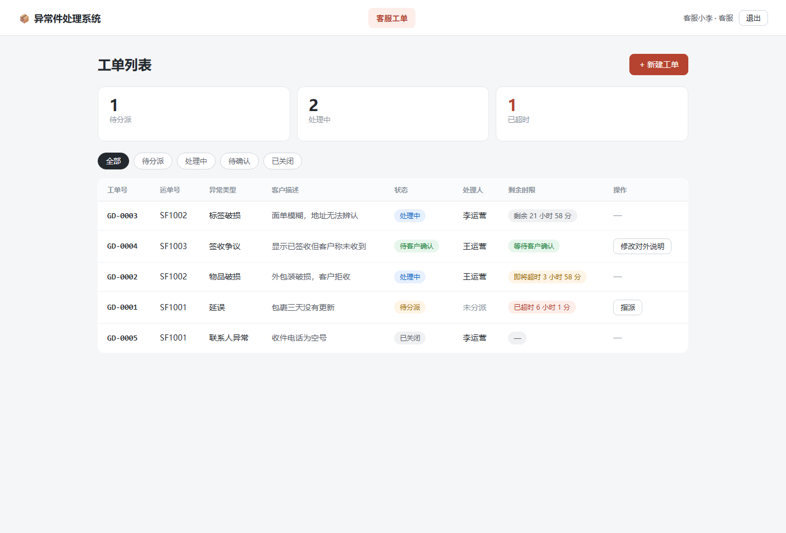
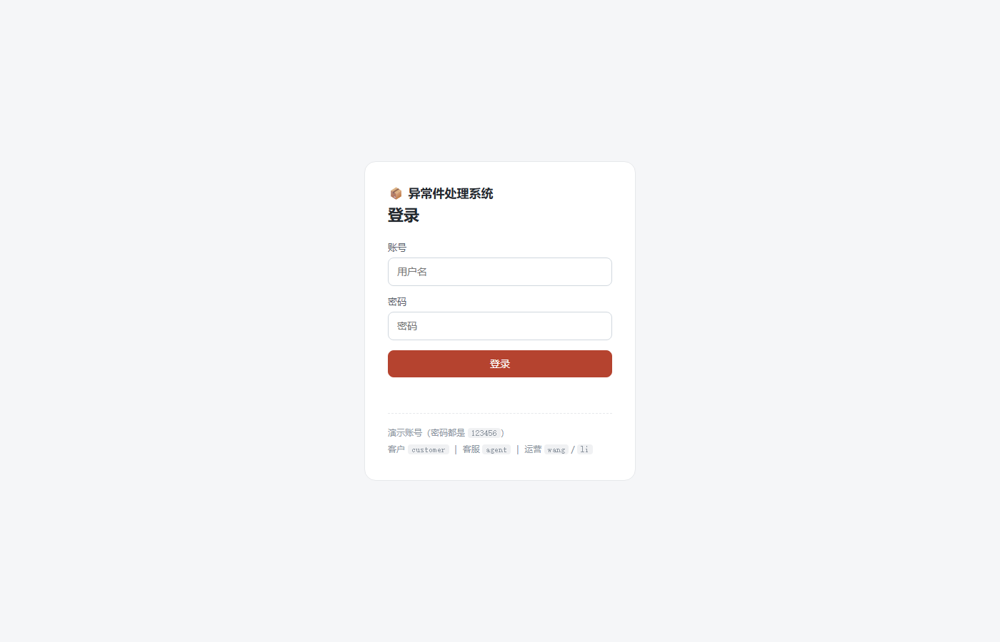

# 快递异常件处理系统

一个面向快递公司客服与站点的**异常件处理系统**：客户查件并反馈异常，客服建单分派，运营核实处理，客服对外说明，客户确认闭环。

不是"展示全国物流轨迹"的系统，而是**处理那一件没有正常到达的包裹**——延误、破损、标签破损、联系人异常、签收争议。



## 目录

- [功能](#功能)
- [技术栈](#技术栈)
- [项目结构](#项目结构)
- [快速开始](#快速开始)
- [接口文档](#接口文档)
- [数据模型](#数据模型)
- [关键设计](#关键设计)
- [测试](#测试)
- [部署](#部署)
- [已知限制](#已知限制)

## 功能

### 账号与角色

登录后按角色进入不同界面，权限由服务端 JWT 令牌决定：

| 角色 | 账号 | 密码 | 能看到 |
|---|---|---|---|
| 客户 | `customer` | `123456` | 自己的工单 |
| 客服 | `agent` | `123456` | 全部工单 |
| 运营 | `wang` / `li` | `123456` | 指派给自己的工单 |



### 客户视角

- 输入运单号查询包裹状态与物流轨迹
- 发现异常时提交反馈（选择异常类型 + 描述）
- 查看自己工单的处理进度与客服回复
- 处理完成后确认解决，或选择"不认可"退回重办


### 客服视角

- 工单列表，按状态筛选（待分派 / 处理中 / 待确认 / 已关闭）
- 新建工单、指派处理人
- 把运营的内部结论整理成**客户能看懂**的对外说明
- 处理时限监控：剩余时间、即将超时、已超时

### 运营视角

- 只看到指派给自己的工单（最小权限）
- 记录核实过程（内部备注）与处理结果（内部）
- 提交后进入"待客户确认"，由客服对外说明


## 技术栈

| 层 | 选型 | 说明 |
|---|---|---|
| 前端 | 原生 HTML / CSS / JavaScript | 无框架、无构建步骤，直接由后端托管 |
| 后端 | Node.js 24 + Express 5 | REST 风格接口 |
| 鉴权 | JWT（`jsonwebtoken`）+ `scrypt` 密码哈希 | 无状态令牌，角色权限在服务端校验 |
| 数据库 | SQLite（`node:sqlite` 内置模块） | 零安装、单文件，适合课程项目与小型部署 |

> 需要 Node.js **≥ 22.5**（`node:sqlite` 从该版本开始提供），推荐使用 Node 24。

## 项目结构

```
express-exception/
├── public/                  # 前端（由后端静态托管）
│   ├── index.html
│   ├── style.css
│   └── app.js
├── server/                  # 后端
│   ├── index.js             # 路由、校验、启动
│   ├── auth.js              # 密码哈希 + JWT 签发/校验
│   ├── db.js                # 数据库连接与建表
│   ├── seed.js              # 首次启动写入演示数据与账号
│   ├── shipments.js         # 运单数据（模拟）
│   ├── test-api.js          # 接口边界与权限测试脚本
│   └── package.json
├── data/app.db              # SQLite 数据库（运行时生成，已 gitignore）
└── docs/screenshots/        # README 截图
```

分层原则：**路由只负责收参和返回，状态机与校验集中在函数里，数据访问集中在 `db` 上**。

## 快速开始

```bash
cd server
npm install
npm run dev
```

看到以下输出即启动成功：

```
API 已启动：http://localhost:3000
前端页面：  http://localhost:3000/index.html
```

浏览器打开 <http://localhost:3000/index.html>。

演示运单号：`SF1001`（延误）、`SF1002`（破损）、`SF1003`（正常）。

演示账号见上方[账号与角色](#账号与角色)，密码统一 `123456`。

`npm run dev` 使用 `node --watch`，修改服务端代码会自动重启。

**重置数据**：停止服务，删除 `data/` 目录，重新启动即可重新写入演示数据（含账号）。

## 接口文档

基础地址：`http://localhost:3000`

除登录与健康检查外，所有接口都需要携带令牌：

```http
Authorization: Bearer <token>
```

| 方法 | 路径 | 说明 | 权限 |
|---|---|---|---|
| GET | `/api/health` | 健康检查 | 公开 |
| POST | `/api/auth/login` | 登录，返回 `{ token, user }` | 公开 |
| GET | `/api/auth/me` | 用令牌换取当前用户信息 | 登录用户 |
| GET | `/api/shipments/:id` | 查询运单 | 登录用户 |
| GET | `/api/tickets` | 工单列表，支持 `?status=` `?trackingId=` | 按角色限定范围 |
| GET | `/api/tickets/:id` | 单个工单详情 | 客服 / 运营 / 该工单的客户 |
| POST | `/api/tickets` | 创建工单 | 客户 / 客服 |
| POST | `/api/tickets/:id/assign` | 指派处理人 | 客服 |
| POST | `/api/tickets/:id/result` | 提交处理结果 | 运营（须为被分派人） |
| POST | `/api/tickets/:id/explain` | 生成对外说明 | 客服 |
| POST | `/api/tickets/:id/confirm` | 客户确认解决 | 该工单的客户 |
| POST | `/api/tickets/:id/reject` | 客户不认可，退回重办 | 该工单的客户 |

### 请求示例

```http
POST /api/auth/login
Content-Type: application/json

{ "username": "agent", "password": "123456" }
```

```http
POST /api/tickets
Authorization: Bearer <token>
Content-Type: application/json

{
  "trackingId": "SF1002",
  "type": "物品破损",
  "note": "外包装破损，客户拒收"
}
```

```http
POST /api/tickets/GD-0006/result
Authorization: Bearer <运营的 token>
Content-Type: application/json

{
  "internalNotes": "已联系武汉站点，确认外箱破损",
  "result": "已重新打包，安排次日派送"
}
```

### 状态码约定

| 码 | 含义 |
|---|---|
| 200 / 201 | 成功 / 创建成功 |
| 400 | 参数错误（缺字段、类型不合法、运单不存在） |
| 401 | 未登录或令牌过期 |
| 403 | 无权限（角色不符，或操作别人的工单） |
| 404 | 资源不存在 |
| 409 | 状态冲突（当前状态不允许该操作） |
| 500 | 服务端异常 |

## 数据模型

### `users`

| 字段 | 说明 |
|---|---|
| `id` | 用户 ID |
| `username` | 登录名，唯一 |
| `password_hash` / `password_salt` | scrypt 哈希后的密码，**不存明文** |
| `role` | `customer` / `agent` / `ops` |
| `display_name` | 显示名（运营的工单就是按这个名字指派的） |

### `tickets`

| 字段 | 类型 | 说明 |
|---|---|---|
| `id` | TEXT | 工单号，如 `GD-0001` |
| `tracking_id` | TEXT | 运单号 |
| `customer_id` | TEXT | 提交人，用于限制客户只能看自己的工单 |
| `type` | TEXT | 异常类型 |
| `status` | TEXT | `pending` / `processing` / `resolved` / `closed` |
| `assignee` | TEXT | 处理人，空串表示未分派 |
| `created_at` | TEXT | 创建时间（ISO 8601 字符串） |
| `note` | TEXT | 客户描述 |
| `internal_notes` | TEXT | 运营核实过程（**客户不可见**） |
| `result` | TEXT | 处理结果（**客户不可见**） |
| `customer_visible_note` | TEXT | 客服整理的对外说明（客户可见） |

### `ticket_history`

| 字段 | 说明 |
|---|---|
| `ticket_id` | 所属工单 |
| `time` | 发生时间 |
| `text` | 记录内容 |
| `visible` | `1` 客户可见 / `0` 仅内部可见 |

### 状态机

```
            指派                提交结果              生成对外说明
  pending ────────> processing ────────> resolved ──────────────> resolved
                       ↑                    │
                       └──── 客户不认可 ─────┘
                                            │
                                  客户确认 ──┴──> closed
```

## 关键设计

### 1. 状态机是唯一的流转规则

前后端各有一份相同的转移表，非法流转一律拒绝：

```js
const TRANSITIONS = {
  pending:    ["processing"],
  processing: ["resolved"],
  resolved:   ["closed", "processing"],
  closed:     [],
};
```

UI 上隐藏按钮只是体验优化，**真正拦住非法操作的是服务端的 409**。

### 2. 三层校验，缺一不可

| 层 | 作用 | 例子 |
|---|---|---|
| 前端 | 体验：即时提示、禁用按钮 | 空值不提交 |
| 服务端 | 规则与安全：不可绕过 | 类型白名单、assignee 校验 |
| 数据库 | 兜底：结构约束 | 主键唯一、NOT NULL |

### 3. 内部信息与客户信息物理分离

不是靠前端 `if` 判断该不该显示，而是**存成不同字段**：

- 内部：`internal_notes`、`result`
- 对外：`customer_visible_note`

客户视图的渲染函数只读 `customer_visible_note`，运营的内部记录永远不会出现在里面。即使以后加了新的接口，也不会因为忘了过滤而泄露。

### 4. 操作留痕与可见性

每次状态变更写入 `ticket_history`，并标记 `visible`：

- 客户提交、客服回复、客户确认 → 客户可见
- 指派给谁、运营内部结论 → 仅内部可见

同时满足"全程可追溯"和"内部信息不外泄"。

### 5. 时限（SLA）计算

```js
const deadline = new Date(ticket.createdAt).getTime() + SLA_HOURS * 3600 * 1000;
const left = deadline - Date.now();
```

时间以 ISO 字符串存储、使用时转 `Date` 计算，剩余不足 4 小时标记"即将超时"，超时后显示已超时时长。

### 6. 防重复提交

请求期间按钮置灰（`disabled` + 文案"提交中…"），并在 `finally` 中恢复。避免网络慢时用户连点产生重复工单。

### 7. 鉴权：身份只从令牌来

早期版本里，前端通过请求体传 `operator: "王运营"` 声明身份——这等于让客户端自己说"我是谁"，改个 JSON 就能冒充别人。

现在改为：

1. 登录时服务端校验密码（`scrypt` 哈希，`timingSafeEqual` 比较），签发 JWT
2. 之后每个请求带 `Authorization: Bearer <token>`
3. 中间件验签，把 `{ id, role, name }` 挂到 `req.user`
4. 所有业务判断只用 `req.user`，**完全忽略请求体里的身份字段**

JWT 结构是三段 Base64：`header.payload.signature`。**payload 是明文可读的**，所以只放 `sub/role/name`，绝不放密码；安全性来自第三段签名——没有密钥就伪造不出合法签名。

### 8. 角色权限在服务端

```js
function requireRole(...roles) {
  return (req, res, next) => {
    if (!roles.includes(req.user.role)) {
      return res.status(403).json({ error: "没有权限执行该操作" });
    }
    next();
  };
}
```

再叠加数据行级限制：客户只能看 `customer_id = 自己` 的工单，运营只能看 `assignee = 自己` 的工单。**"看不到"和"不能改"是两件事，两层都要做。**

## 测试

服务启动后执行：

```bash
cd server
node test-api.js
```

覆盖 11 个用例，包括未登录、错误密码、角色越权、状态流转：

```
✅ 未登录访问工单列表  期望 401，实际 401
✅ 错误密码登录        期望 401，实际 401
✅ 客户登录            期望 200，实际 200
✅ 客服登录            期望 200，实际 200
✅ 运营登录            期望 200，实际 200
✅ 客户可查询自己的工单 期望 200，实际 200
✅ 客户不能指派工单     期望 403，实际 403
✅ 客服可以指派         期望 200，实际 200
✅ 李运营提交别人工单   期望 403，实际 403
✅ 王运营提交自己的工单 期望 200，实际 200
✅ 客户确认解决         期望 200，实际 200

通过 11，失败 0
```

## 部署

### 环境变量

| 变量 | 说明 | 默认值 |
|---|---|---|
| `PORT` | 监听端口（云平台通常自动注入） | `3000` |
| `JWT_SECRET` | 令牌签名密钥，**生产必须改** | 内置开发值 |
| `DATA_DIR` | 数据库文件目录，指向持久磁盘 | `../data` |

生成一个随机密钥：

```bash
node -e "console.log(require('crypto').randomBytes(32).toString('hex'))"
```

### 方案 A：Render（免费，最快拿到公网链接）

1. 注册 <https://render.com>，用 GitHub 账号登录
2. **New +** → **Web Service** → 选择 `express-exception` 仓库
3. 填写：
   - **Root Directory**：`server`
   - **Build Command**：`npm install`
   - **Start Command**：`npm start`
4. 在 **Environment Variables** 添加 `JWT_SECRET`（上一步生成的随机串）
5. 点 **Create Web Service**，等待构建完成，得到一个 `https://xxx.onrender.com` 地址

⚠️ 免费实例的两个限制：

- 15 分钟无访问会休眠，下次访问需冷启动约 30 秒
- **磁盘是临时的**，重新部署或重启后 `data/app.db` 会重置为种子数据

只做演示够用；要长期保存数据，选方案 B 或给 Render 挂付费磁盘并设置 `DATA_DIR`。

### 方案 B：有持久磁盘的服务器（推荐长期）

学生机（阿里云 / 腾讯云）或 Zeabur / Railway / Fly.io 都可以。核心三点：

1. 装 Node ≥ 22.5
2. 拉代码、`cd server && npm install`
3. 用 `JWT_SECRET=... DATA_DIR=/var/data PORT=3000 npm start` 启动，并用 `systemd` 或 `pm2` 守护进程

### 方案 C：Docker

```bash
docker build -t express-exception .
docker run -d -p 3000:3000 \
  -e JWT_SECRET=<你的密钥> \
  -v $(pwd)/data:/app/data \
  express-exception
```

### 部署后自检

1. 打开首页能进入登录页（说明静态资源正常）
2. 用 `agent` / `123456` 能登录（说明数据库已初始化）
3. 新建一个工单，**重启服务**后刷新，数据还在（说明持久化生效）
4. 直接访问 `/api/tickets`（不带令牌）应返回 401

## 已知限制

诚实列出，避免过度包装：

1. **令牌存在 `localStorage`**，一旦页面存在 XSS 漏洞，令牌可被脚本读取。生产环境应改为 `HttpOnly` Cookie + CSRF 防护。
2. **令牌 7 天有效且无法主动吊销**，没有刷新令牌机制，用户改密码后旧令牌仍然可用。
3. **角色是硬编码的三种**，没有权限管理后台，新增角色要改代码。
4. **运单数据是静态模拟**，未接入真实物流接口。
5. **工单列表无分页、无搜索**，数据量大时会有性能问题。
6. **SQLite 单机存储**，适合演示与小型部署，无法水平扩展。
7. **未使用测试框架**，`test-api.js` 是脚本级验证，不是单元测试。

## 后续计划

- [x] JWT 登录与角色权限（客户 / 客服 / 运营）
- [ ] 令牌改存 `HttpOnly` Cookie，加入刷新令牌与主动吊销
- [ ] 工单分页、关键词搜索
- [ ] 操作审计与导出报表
- [ ] 单元测试（node:test）与接口集成测试
- [ ] Docker 化与线上部署
